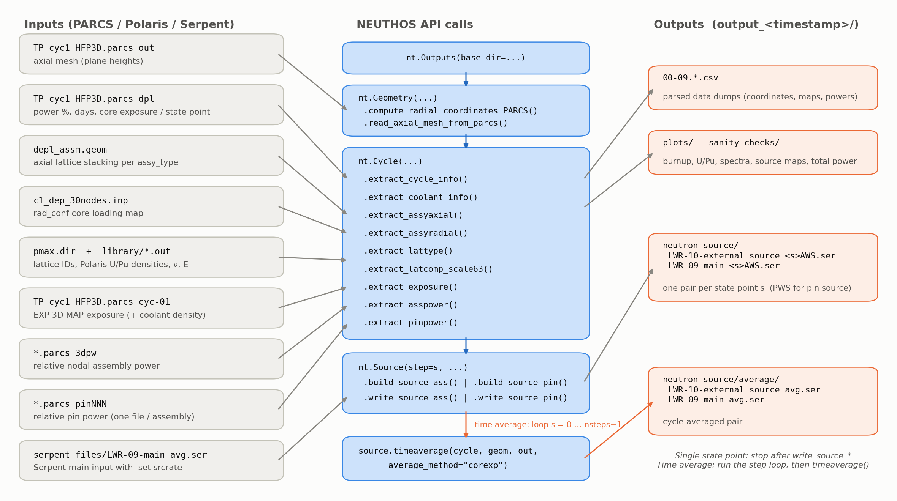
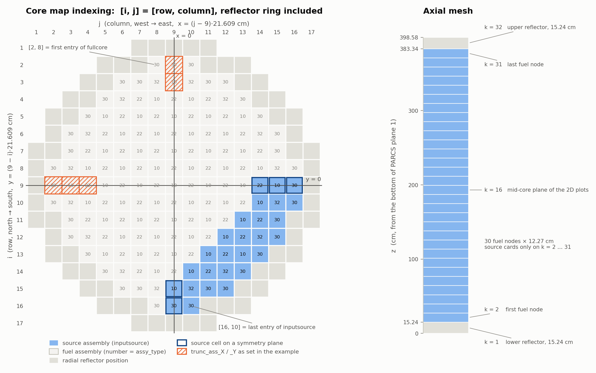
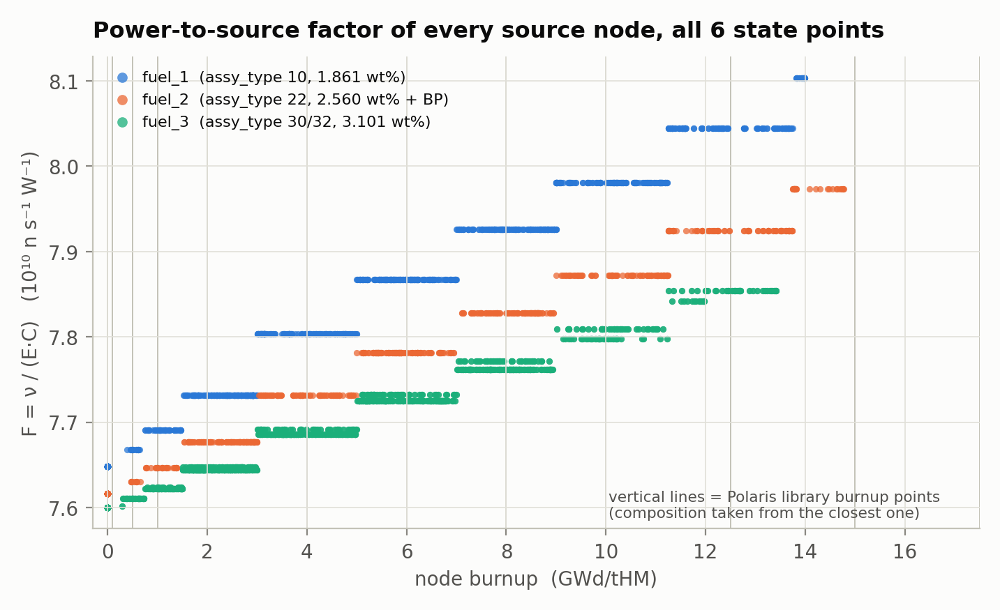
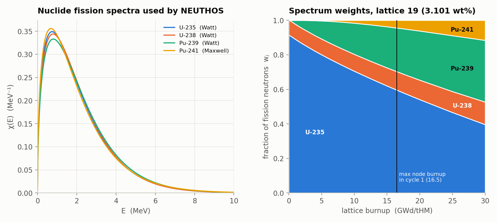
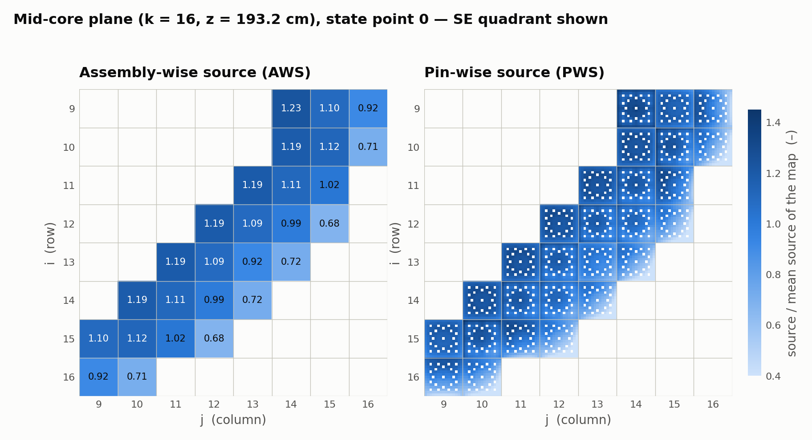
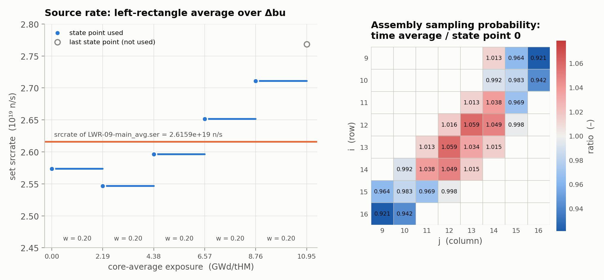
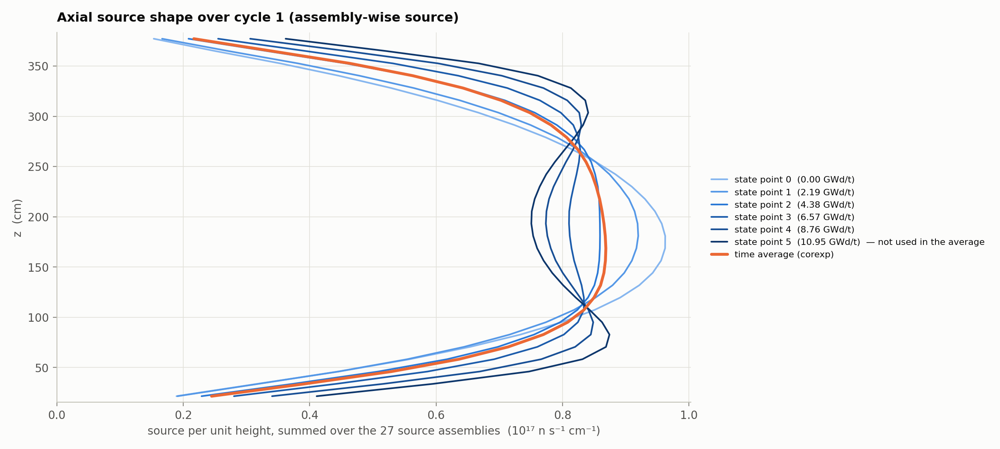

# Building a PARCS-based neutron source with NEUTHOS

This guide walks through the two PARCS example scripts in this folder, line by line:

| Script                                                                      | What it produces                                                                                      |
| --------------------------------------------------------------------------- | ----------------------------------------------------------------------------------------------------- |
| [run_parcs_cycle1_singlestatepoint.py](run_parcs_cycle1_singlestatepoint.py) | a Serpent source for **one** PARCS state point, assembly-wise (AWS) and pin-wise (PWS)          |
| [run_parcs_cycle1_timeaverage.py](run_parcs_cycle1_timeaverage.py)           | one source **per** state point, then a single exposure-weighted **cycle-averaged** source |

The two scripts share the same first part (geometry, cycle data, powers). They only differ in
how many state points are turned into a source and whether those sources are averaged.
The example is cycle 1 of a 157-assembly 15×15 PWR followed by PARCS over 6 depletion state points
(0 to 350 days, 0 to 10.95 GWd/tHM core-average exposure).

All figures in this guide were made from the files in `parcs_files/`, using the two scripts as they are in the repository.



---

## 1. What NEUTHOS computes

For every assembly *m*, pin *p* and axial node *z* of the source region, the PARCS power
$P$ (W) is converted into a fission-neutron emission rate:

$$
S_{m,p}^{z} = P_{m,p}^{z}\,\frac{\nu_m^{z}}{E_m^{z}\,C}, \qquad C = 1.6019\times10^{-13}\ \mathrm{J/MeV}
$$

where $\nu$ is the mean number of neutrons per fission and $E$ the energy recovered per fission (MeV).
Each node is also given the emission spectrum of its assembly:

$$
\chi_m(E) = \sum_{i} w_m^{i}\,\chi^{i}(E), \qquad
w_m^{i} = \frac{\nu^{i}\rho_m^{i}\sigma_f^{i}}{\sum_j \nu^{j}\rho_m^{j}\sigma_f^{j}},
\qquad i \in \{^{235}\mathrm{U},\ ^{238}\mathrm{U},\ ^{239}\mathrm{Pu},\ ^{241}\mathrm{Pu}\}
$$

The result is written in Serpent syntax:

* `LWR-10-external_source_*.ser` holds one `src` card per node (AWS) or per fuel pin and node (PWS).
  The card weight `sw` is the sampling probability $S/\sum S$, and each card carries its own spectrum.
* `LWR-09-main_*.ser` is a copy of your Serpent main input whose `set srcrate` is replaced by
  $\sum S$ (n/s), so Serpent normalises its tallies to the real source strength.

| Choice             | Options                                                                                                                                                                    |
| ------------------ | -------------------------------------------------------------------------------------------------------------------------------------------------------------------------- |
| spatial resolution | **AWS**: one card per assembly × axial node, sampled uniformly in the fuel material of that box. **PWS**: one card per fuel pin × axial node (point or box). |
| time treatment     | **single state point**: one source for the chosen PARCS step. **time average**: one source per step, then a burnup-weighted cycle average.                     |

---

## 2. Before you start

**Python environment.** Python ≥ 3.10 with `numpy`, `scipy`, `matplotlib`, `pandas` and `h5py`.
Install NEUTHOS from the repository root:

```bash
pip install -e .            # or: export PYTHONPATH=<repo>/src
```

The source plots use matplotlib's 3D projection. If a mixed system/pip matplotlib installation
cannot import `mpl_toolkits.mplot3d`, the scripts stop with `ValueError: Unknown projection '3d'`.
Use a clean virtual environment in that case.

**Run from this folder.** The scripts use relative paths:

```bash
cd examples/PWR_source_3D
python run_parcs_cycle1_singlestatepoint.py      # ~20 s
python run_parcs_cycle1_timeaverage.py           # ~20 s
```

Each run creates a new `output_<YYYYmmdd_HHMMSS>/` folder, which is git-ignored.

> **Disk space.** A PWS external-source file is large: every pin card carries its own 200-line
> spectrum. In this example the file is **767 MB per state point** (165 240 cards), against
> 3.8 MB for the AWS file (810 cards).

**Input files.** All of these sit in `parcs_files/` and `serpent_files/`:

| File                                  | Read by                                                    | What NEUTHOS takes from it                                                               |
| ------------------------------------- | ---------------------------------------------------------- | ---------------------------------------------------------------------------------------- |
| `TP_cyc1_HFP3D.parcs_out`           | `Geometry.read_axial_mesh_from_parcs`                    | node centre heights and node heights (*Axial Power Distribution* table)                |
| `TP_cyc1_HFP3D.parcs_dpl`           | `Cycle.extract_cycle_info`                               | power level (%), days and core exposure of each state point                              |
| `TP_cyc1_HFP3D.parcs_cyc-01`        | `Cycle.extract_exposure`, `Cycle.extract_coolant_info` | `EXP 3D MAP` nodal exposure (and `DCO 3D MAP` coolant density) for every state point |
| `depl_assm.geom`                    | `Cycle.extract_assyaxial`                                | axial lattice stacking of every `assy_type` (`30*13` = 30 planes of lattice 13)      |
| `c1_dep_30nodes.inp`                | `Cycle.extract_assyradial`                               | `rad_conf` core loading map (`assy_type` at every position)                          |
| `pmax.dir`                          | `Cycle.extract_lattype`                                  | lattice IDs, fuel/reflector flag and the Polaris reference case of each fuel lattice     |
| `library/<latID>_<case>.out`        | `Cycle.extract_latcomp_scale63`                          | Polaris (SCALE 6.3) output for each fuel lattice: U/Pu densities, ν, E versus burnup    |
| `*.parcs_3dpw`                      | `Cycle.extract_asspower`                                 | relative nodal assembly power for every state point                                      |
| `*.parcs_pin001 … pinNNN`          | `Cycle.extract_pinpower`                                 | relative pin power, one file per fuel assembly                                           |
| `serpent_files/LWR-09-main_avg.ser` | `Source.write_source_*`                                  | Serpent main input used as a template: only its `set srcrate` line is rewritten        |

---

## 3. Step by step

### Step 1: output folder

```python
timestamp = datetime.now().strftime("%Y%m%d_%H%M%S")
out = nt.Outputs(base_dir=f"output_{timestamp}")
```

Every CSV, plot, sanity check and Serpent file is written below `base_dir`. Relative paths passed
to the `out.write_*` methods are interpreted relative to it.

### Step 2: core map and source assemblies

`fullcore` lists the `[i, j]` position of **every fuel assembly** (157 here). `inputsource` lists
the assemblies that receive source cards: here, the 27 peripheral assemblies of the south-east quadrant.
Assemblies outside `inputsource` are ignored when the source is built, both for AWS and PWS.

The indices follow the PARCS 17×17 map, **reflector ring included**:

* `i` is the row, counted north → south.
* `j` is the column, counted west → east.

The core centre `[9, 9]` sits at x = y = 0, and the Serpent coordinates of an assembly centre are

$$
x = \left(j - \tfrac{n_{ass}+1}{2}\right) p_{ass}, \qquad y = \left(\tfrac{n_{ass}+1}{2} - i\right) p_{ass}
$$



### Step 3: geometry

```python
geom = nt.Geometry(naxial=32, nass=17, npin=15, latsym="se",
                   ngtubes=20, nitubes=1, ngtubesqtr=6, nitubesqtr=1,
                   ass_pitch=21.60912, pin_pitch=1.43511, pin_radius=0.4677,
                   active_height=368.26, coremap=fullcore, source=inputsource)
geom.compute_radial_coordinates_PARCS()
geom.read_axial_mesh_from_parcs("parcs_files/TP_cyc1_HFP3D.parcs_out")
out.write_PARCS_pin_coordinates(geom, "00.parcs_pin_coordinates.csv")
```

| Parameter                         | Example                       | Meaning                                                                                                                               |
| --------------------------------- | ----------------------------- | ------------------------------------------------------------------------------------------------------------------------------------- |
| `naxial`                        | 32                            | PARCS axial planes, **including** the bottom (k = 1) and top (k = 32) reflectors; source cards are written only for k = 2 … 31 |
| `nass`                          | 17                            | assemblies per core row, reflector ring included                                                                                      |
| `npin`                          | 15                            | pins per assembly row                                                                                                                 |
| `ngtubes`, `nitubes`          | 20, 1                         | guide and instrument tubes per assembly, so 225 − 21 = **204 fuel pins**                                                       |
| `latsym`                        | `"se"`                      | symmetry of the Polaris lattice output (`"full"` or `"se"` quarter); only affects how the Polaris ν map is averaged              |
| `ngtubesqtr`, `nitubesqtr`    | 6, 1                          | guide/instrument tubes in the quarter lattice (needed when `latsym="se"`)                                                           |
| `ass_pitch`, `pin_pitch`      | 21.60912, 1.43511 cm          | used for the card coordinates                                                                                                         |
| `pin_radius`, `active_height` | 0.4677, 368.26 cm             | define the fuel volume used to turn relative power into watts                                                                         |
| `coremap`, `source`           | `fullcore`, `inputsource` | see Step 2                                                                                                                            |

`read_axial_mesh_from_parcs` looks for the table header `Number (cm) (cm) Integ. Assm.` and reads
exactly `naxial` rows. If it finds a different number of planes, it raises a `ValueError`.
Heights are measured from the **bottom of PARCS plane 1**, so the fuel spans 15.24 to 383.34 cm.
Your Serpent geometry must use the same axial origin, or the `sz`/`sp` values must be shifted.

### Step 4: cycle data

```python
cycle = nt.Cycle(nassembly_with_reflectors=221, polarisoption=0, nsteps=6, asspower=14.0127e6)
```

| Parameter                     | Example   | Meaning                                                                                                                        |
| ----------------------------- | --------- | ------------------------------------------------------------------------------------------------------------------------------ |
| `nassembly_with_reflectors` | 221       | non-zero entries of `rad_conf` (157 fuel + 64 reflector positions), which is also the number of columns of the PARCS 3D maps |
| `polarisoption`             | 0         | where ν, E and χ come from (table below)                                                                                     |
| `nsteps`                    | 6         | number of state points in `.parcs_dpl`                                                                                       |
| `asspower`                  | 14.0127e6 | assembly power at 100 % in **W** (here 2200 MW / 157)                                                                    |

| `polarisoption`      | ν and E                                                                  | spectrum χ                                                     | AWS | PWS |
| ---------------------- | ------------------------------------------------------------------------- | --------------------------------------------------------------- | --- | --- |
| **0** (examples) | literature ν<sub>i</sub>, E<sub>i</sub>, weighted with Polaris densities | analytical Watt/Maxwell                                         | ✓  | ✓  |
| 1                      | Polaris lattice values                                                    | analytical                                                      | ✓  | ✓  |
| 2                      | literature                                                                | Polaris 252-group χ (needs `groups=` and fine-group outputs) | ✓  | –  |
| 3                      | Polaris lattice values                                                    | Polaris 252-group χ                                            | ✓  | –  |

> **Check before using options 1 or 3.** Compare the ν column of `05.lattice_composition_data.csv`
> with the *Neutrons Per Fission* map in the Polaris output. With the library in this folder and
> `latsym="se"`, the CSV reads 2.87 for fresh 1.861 wt% fuel, while the Polaris map averages 2.46.

Then call the parsers in the order of the script, because later calls use earlier results.
`extract_exposure` needs `extract_assyradial`, `extract_latcomp_scale63` needs `extract_lattype`,
and the power parsers need `extract_cycle_info` and the axial mesh:

| Call                                               | Result                                                              | Dumped to                                            |
| -------------------------------------------------- | ------------------------------------------------------------------- | ---------------------------------------------------- |
| `extract_cycle_info(".parcs_dpl")`               | power %, days, core exposure per state point                        | console                                              |
| `extract_coolant_info(geom, ".parcs_cyc-01")`    | coolant density per node (diagnostic; not used by the source)       | `01.coolant_density_0.csv`                         |
| `extract_assyaxial("depl_assm.geom")`            | lattice ID per plane for each `assy_type`                         | `02.assembly_axial_configuration.csv`              |
| `extract_assyradial(geom, "c1_dep_30nodes.inp")` | `assy_type` at every `[i, j]`                                   | `03.assembly_radial_configuration.csv`             |
| `extract_lattype("pmax.dir")`                    | fuel and reflector lattice IDs                                      | `04.lattice_type_data.csv`                         |
| `extract_latcomp_scale63(geom, "library")`       | for every library burnup point: E, U-235, U-238, Pu-239, Pu-241, ν | `05.lattice_composition_data.csv`                  |
| `extract_exposure(geom, ".parcs_cyc-01")`        | exposure of every node, assembly and state point                    | `06.cycle_exposure.csv`, `07.exposure_step0.csv` |
| `extract_asspower(geom, out, "parcs_files")`     | nodal assembly power in W                                           | `08.assembly_power_data.csv`                       |
| `extract_pinpower(geom, out, "parcs_files")`     | pin power in W per node                                             | `09.pin_power_data.csv`                            |

The power parsers turn the PARCS relative power $p$ into watts:

$$
P_{\text{assy node}} = p\,P_{assy}\,\frac{h_k}{H_{act}}\,\frac{\text{Power}\,\%}{100},
\qquad
P_{\text{pin node}} = p\,\frac{P_{assy}}{n_{fuel}}\,\frac{h_k}{H_{act}}\,\frac{\text{Power}\,\%}{100}
$$

**First sanity check:** `sanity_checks/ass_source/sanity_check_ass_<s>.txt` must give the core
power. Here it gives 2.199 × 10⁹ W (≈ 157 × 14.0127 MW) over 4710 nodes (157 × 30).

### Step 5: build the source

```python
assembly_source = nt.Source(
    step=0,                                   # 0-based state point index
    bins=np.linspace(0, 20, 200),             # energy bin edges (MeV) -> 199 bins
    truncoption=True,
    trunc_ass_X=[[2, 9], [3, 9]],
    trunc_ass_Y=[[9, 2], [9, 3], [9, 4]],
    assytype_to_mcmaterial={"10": "fuel_1", "20": "fuel_2", "22": "fuel_2",
                            "30": "fuel_3", "32": "fuel_3", "40": "fuel_4",
                            "50": "fuel_5", "60": "fuel_6"})
assembly_source.build_source_ass(cycle, geom, out)
```

| Parameter                    | Meaning                                                                                                                                            |
| ---------------------------- | -------------------------------------------------------------------------------------------------------------------------------------------------- |
| `step`                     | state point to use, from 0 to `nsteps − 1` (PARCS state point `step + 1`)                                                                     |
| `bins`                     | energy bin edges in MeV; the spectrum is evaluated at the bin centres and normalised to Σ χ ΔE = 1                                              |
| `truncoption`, `trunc_*` | symmetry truncation for a quarter-core Serpent model, see Step 6                                                                                   |
| `sourceoption`             | PWS only: `'pointsource'` (a point at the pin centre, node mid-height) or `'volumesource'` (a pin × node box restricted to the fuel material) |
| `assytype_to_mcmaterial`   | `assy_type` → Serpent fuel material name used by `sm`; every `assy_type` present in `inputsource` must be a key                           |

`build_source_ass` goes through these steps for every assembly:

1. Read its exposure profile at `step` from `extract_exposure`.
2. For each fuel node, take the U/Pu densities, ν and E of the **closest library burnup point**
   of that node's lattice. The densities are not interpolated between library points.
3. Compute ν and E as the fission-rate-weighted averages of the four nuclides (option 0), then
   the power-to-source factor $F = \nu/(E\,C)$.
4. Build **one spectrum per assembly** from its axially averaged densities.
5. For each node of an `inputsource` assembly, store $S = P \cdot F$ in `assembly_source.sourceassy`.

Constants used for option 0 (`source.py`):

|                                       | U-235               | U-238               | Pu-239              | Pu-241          |
| ------------------------------------- | ------------------- | ------------------- | ------------------- | --------------- |
| σ<sub>f</sub> (b, CASMO-4 one-group) | 566.0               | 1.5                 | 781.0               | 1060.0          |
| ν                                    | 2.430               | 2.810               | 2.871               | 2.969           |
| E (MeV)                               | 201.7               | 205.0               | 210.0               | 212.4           |
| χ(E)                                 | Watt (0.988, 2.249) | Watt (0.920, 3.121) | Watt (0.966, 2.842) | Maxwell (1.360) |

Figure 3 shows the effect of these steps. Over the cycle F rises by 3–7 % as plutonium builds up,
and it moves in steps because each node snaps to the nearest library burnup point.
At equal burnup, lower-enriched fuel has a higher F, because U-238 and plutonium produce a larger
share of its fissions.



Figure 6 shows the spectrum side. The four nuclide spectra are close to each other, so the main
effect of burnup on the spectrum is the growing plutonium share of the fission neutrons.



**Pin-wise source.** `build_source_pin` uses the same assembly-level factor F and spectrum, but
applies them to the pin powers from `extract_pinpower`. Zero-power positions (guide and instrument
tubes) are skipped. Only `polarisoption` 0 and 1 are supported.

```python
pin_source = nt.Source(step=0, bins=np.linspace(0, 20, 200), truncoption=True,
                       sourceoption='pointsource', ..., assytype_to_mcmaterial={...})
pin_source.build_source_pin(cycle, geom, out)
```

### Step 6: symmetry truncation (quarter-core Serpent models only)

If Serpent models only the south-east quarter with reflective planes at x = 0 and y = 0, the
source assemblies cut by those planes (the boxed cells in Figure 2) must keep only the half that
lies inside the model. With `truncoption=True`:

| List                                    | Effect                                                                                                                  |
| --------------------------------------- | ----------------------------------------------------------------------------------------------------------------------- |
| `trunc_ass_X`                         | assemblies cut by the plane **x = 0** (column 9): AWS source halved, `sx` limited to the half facing the source |
| `trunc_ass_Y`                         | assemblies cut by the plane **y = 0** (row 9): AWS source halved, `sy` limited to the half facing the source    |
| `trunc_pin_X` / `trunc_pin_Y`       | PWS: pins `[m, n]` (pin row, pin column) of those assemblies that lie outside the model and are dropped               |
| `trunc_pinsym_X` / `trunc_pinsym_Y` | PWS: pins lying on the plane, which are halved (half-pin box for `volumesource`)                                      |

The side to keep is detected from the position of `inputsource`, and printed as
`Truncation symmetry planes: keeping the +x and -y half ...`.

>
> For a south-east **quarter-core** model, use:
>
> ```python
> trunc_ass_X    = [[15, 9], [16, 9]]                                 # cut by x = 0
> trunc_ass_Y    = [[9, 14], [9, 15], [9, 16]]                        # cut by y = 0
> # PWS, 15x15 lattice: pin column/row 8 lies on the plane
> trunc_pin_X    = [[m, n] for m in range(1, 16) for n in range(1, 8)]  # west half: dropped
> trunc_pinsym_X = [[m, 8] for m in range(1, 16)]                       # on x = 0: halved
> trunc_pin_Y    = [[m, n] for m in range(1, 8) for n in range(1, 16)]  # north half: dropped
> trunc_pinsym_Y = [[8, n] for n in range(1, 16)]                       # on y = 0: halved
> ```
>
> With these lists, `[9,14]` drops from 1.17 × 10¹⁸ to 5.87 × 10¹⁷ n/s, its cards span
> `sy -10.80 … 0.00`, and each cut assembly keeps 108 of its 204 pin cards per node.

### Step 7: write the Serpent files

```python
out.write_asssourceinfo_to_csv(assembly_source, "09.assembly_source_info.csv")
out.visualize_source_ass(geom, assembly_source, '3D')
out.visualize_source_ass(geom, assembly_source, '2D')
assembly_source.write_source_ass(cycle, geom, out, "serpent_files/LWR-09-main_avg.ser")
```

`write_source_ass` writes two files to `neutron_source/`:

```text
LWR-10-external_source_0AWS.ser      # 810 cards = 27 assemblies x 30 fuel nodes
LWR-09-main_0AWS.ser                 # template copy with set srcrate 2.57371e+19
```

Anatomy of one AWS card. The `sx`/`sy`/`sz` box is the assembly × node volume; `sm` restricts
sampling to the fuel material; `sb 200 1` introduces the 200 lines of the spectrum:

```text
src 1 n sw 3.35866e-04 sx 9.72410e+01 1.18850e+02 sy -1.08046e+01 1.08046e+01 sz 3.71095e+02 3.83365e+02 sm fuel_2 sb 200 1
1E-11 0.0
1.00503e-01 1.42196e-01
2.01005e-01 2.31032e-01
...
2.00000e+01 2.92259e-07
```

A PWS point-source card has the same structure, with `sp x y z` instead of the box:

```text
src 1 n sw 2.28911e-06 sp 9.79998e+01 1.00458e+01 2.13800e+01 sb 200 1
```

> **Edit the `include` line.** Only `set srcrate` is rewritten in the main file. The template's
> `include 'LWR-10-external_source_parcs30dep1.ser'` is copied as is: point it to the new
> external source file (or rename that file) before running Serpent.



The plots in `plots/` are named after the PARCS state point number, so step 0 gives
`assembly_source_definition_t1_2D.png`. The Serpent files are named after `step`, so step 0 gives
`..._0AWS.ser`.

---

## 4. Path A: single state point

[run_parcs_cycle1_singlestatepoint.py](run_parcs_cycle1_singlestatepoint.py) runs Steps 1 to 7
once with `step = 0`, first for AWS and then for PWS:

```python
assembly_source = nt.Source(step=0, ...)
assembly_source.build_source_ass(cycle, geom, out)
assembly_source.write_source_ass(cycle, geom, out, "serpent_files/LWR-09-main_avg.ser")

pin_source = nt.Source(step=0, sourceoption='pointsource', ...)
pin_source.build_source_pin(cycle, geom, out)
pin_source.write_source_pin(cycle, geom, out, "serpent_files/LWR-09-main_avg.ser")
```

To use another state point, change `step` (0 … 5) in both `nt.Source` calls. Results for step 0:

|                       | AWS                                                           | PWS                                                 |
| --------------------- | ------------------------------------------------------------- | --------------------------------------------------- |
| cards                 | 810                                                           | 165 240 (27 × 30 × 204)                           |
| `set srcrate` (n/s) | 2.57371 × 10¹⁹                                             | 2.57372 × 10¹⁹                                   |
| files                 | `LWR-10-external_source_0AWS.ser`, `LWR-09-main_0AWS.ser` | `..._0PWS.ser` (767 MB), `LWR-09-main_0PWS.ser` |

AWS and PWS give the same total. They distribute the same power with the same factors and only
differ in where inside the assembly the neutrons are born (Figure 4).

---

## 5. Path B: cycle time average

[run_parcs_cycle1_timeaverage.py](run_parcs_cycle1_timeaverage.py) repeats Steps 5 to 7 for every
state point, then averages the files on disk:

```python
AWS_flag = True
PWS_flag = False

for step in range(cycle.nsteps):
    if AWS_flag:
        assembly_source = nt.Source(step=step, ...)
        assembly_source.build_source_ass(cycle, geom, out)
        assembly_source.write_source_ass(cycle, geom, out, "serpent_files/LWR-09-main_avg.ser")
    if PWS_flag:
        ...

if AWS_flag:
    assembly_source.timeaverage(cycle, geom, out, average_method='corexp')
```

`timeaverage` reads every `LWR-10-external_source_<s>*.ser` / `LWR-09-main_<s>*.ser` pair in
`neutron_source/` and computes left-rectangle weights over the state points:

$$
\texttt{corexp}:\ w_s = \frac{bu_{s+1}-bu_s}{bu_{N-1}-bu_0}
\qquad
\texttt{efpd}:\ w_s \propto \tfrac12\left(\tfrac{P_s+P_{s+1}}{100}\right)(t_{s+1}-t_s),
\qquad s = 0 \dots N-2
$$

The weights are then applied card by card:

* **sampling probability**: $\bar{sw}_c = \sum_s w_s\, sw_{c,s}$, renormalised to sum to 1;
* **spectrum**: $\bar\chi_c = \sum_s w_s\, \chi_{c,s}$, renormalised to unit integral;
* **source rate**: $\overline{\mathrm{srcrate}} = \sum_s w_s\, \mathrm{srcrate}_s$.

Card positions and materials are taken from the step-0 file, and cards whose step-0 weight is
zero are dropped. The **last state point is not used**: it only closes the last interval.
The result goes to a separate folder, so a later call does not pick it up as a state point:

```text
neutron_source/average/LWR-10-external_source_avg.ser
neutron_source/average/LWR-09-main_avg.ser          # set srcrate 2.61591e+19
```

In this example every interval is 2.19 GWd/t (70 days at 100 %), so `corexp` and `efpd` both give
w = 0.20 for state points 0 to 4.



Averaging over the cycle matters for the axial shape as well as for the strength. At the start
of the cycle the source peaks at mid-core. As the centre burns down, it develops two humps near
z ≈ 80 cm and z ≈ 300 cm. The average lies between the two (Figure 5). Radially, compared with
state point 0, the four outermost assemblies (`[9,16]`, `[10,16]`, `[16,9]`, `[16,10]`) lose 6–8 %
of their sampling probability, and the inner source assemblies gain up to 6 % (Figure 7, right).



> **Run one flag at a time.** `timeaverage` identifies the per-step files by their step number
> only, and both averages are written under the same `*_avg.ser` names. With `AWS_flag` and
> `PWS_flag` both `True`, the PWS files replace the AWS ones in the average and only a PWS
> average remains. Run the script once per source type, in separate output folders.

Other things to know about the time-average run:

* `09.assembly_source_info.csv` / `09.pin_source_info.csv` are rewritten at every step, so they hold the last state point.
* The per-step plots (`plots/assembly_source_definition_t<s+1>_*.png`, `plots/ass_source/*_<s>.png`) are all kept.
* With `PWS_flag = True`, plan for 6 × 767 MB of per-step files plus the average.

---

## 6. Adapting the scripts to your own core

1. **File names**: replace `TP_cyc1_HFP3D.*`, `depl_assm.geom`, `c1_dep_30nodes.inp`,
   `pmax.dir` and `library/` with your PARCS/Polaris files. `extract_asspower` and
   `extract_pinpower` read every `*.parcs_3dpw` / `*.parcs_pin*` file in the folder you pass, so
   keep only one case per folder.
2. **Geometry**: set `naxial` (fuel planes + 2 reflectors), `nass`, `npin`, pitches, tube counts,
   `pin_radius` and `active_height`.
3. **Maps**: write `fullcore` from your `rad_conf`, and choose `inputsource` (Figure 2 shows the indexing).
4. **Cycle**: set `nsteps` to the number of state points in `.parcs_dpl`,
   `nassembly_with_reflectors` to the number of non-zero `rad_conf` entries, and `asspower` in W.
5. **Materials**: map every `assy_type` of the source assemblies to a fuel material of your Serpent model.
6. **Truncation**: `truncoption=False` (or lists outside `inputsource`) for a full-core model;
   the Step 6 lists for a south-east quarter.
7. **Serpent template**: the main input must contain a `set srcrate` line, and its `include`
   must point to the generated external source file.
8. **Check**: total power in `sanity_checks/`, the 2D map in `plots/`, and the first lines of
   the `.ser` file (`sz` inside the fuel, materials as expected).

---

## 7. Output folder reference

```text
output_<timestamp>/
├── 00.parcs_pin_coordinates.csv           # (i, j, m, n, x_pin, y_pin) for every pin position
├── 01.coolant_density_0.csv               # DCO map, state point 0
├── 02.assembly_axial_configuration.csv    # lattice stacking per assy_type
├── 03.assembly_radial_configuration.csv   # assy_type at every [i, j]
├── 04.lattice_type_data.csv               # pmax.dir content
├── 05.lattice_composition_data.csv        # Polaris E, U/Pu densities, nu per burnup point
├── 06.cycle_exposure.csv                  # exposure index of every fuel assembly
├── 07.exposure_step0.csv                  # nodal exposure map of exposure[:, :, 5] (the last state point)
├── 08.assembly_power_data.csv             # (state point, i, j, k, W)
├── 09.pin_power_data.csv                  # (state point, i, j, k, m, n, W, relative)
├── 09.assembly_source_info.csv            # (state point, i, j, k, W, n/s, spectrum, material)
├── 09.pin_source_info.csv                 # PWS equivalent
├── plots/                                 # source maps (t = state point + 1), burnup, U/Pu, spectra
├── sanity_checks/                         # total power per state point, burnup and spectrum CSVs
└── neutron_source/
    ├── LWR-10-external_source_<s>AWS.ser  # src cards (PWS for the pin source)
    ├── LWR-09-main_<s>AWS.ser             # template with set srcrate
    └── average/                           # time-average path only
        ├── LWR-10-external_source_avg.ser
        └── LWR-09-main_avg.ser
```

For the method itself, see the *Theory* page of the NEUTHOS documentation and
Timpano & Hursin (2025), *Development of a Polaris/PARCS/Serpent methodology for reactor pressure
vessel neutron fluence calculations*, ISRD-18.
